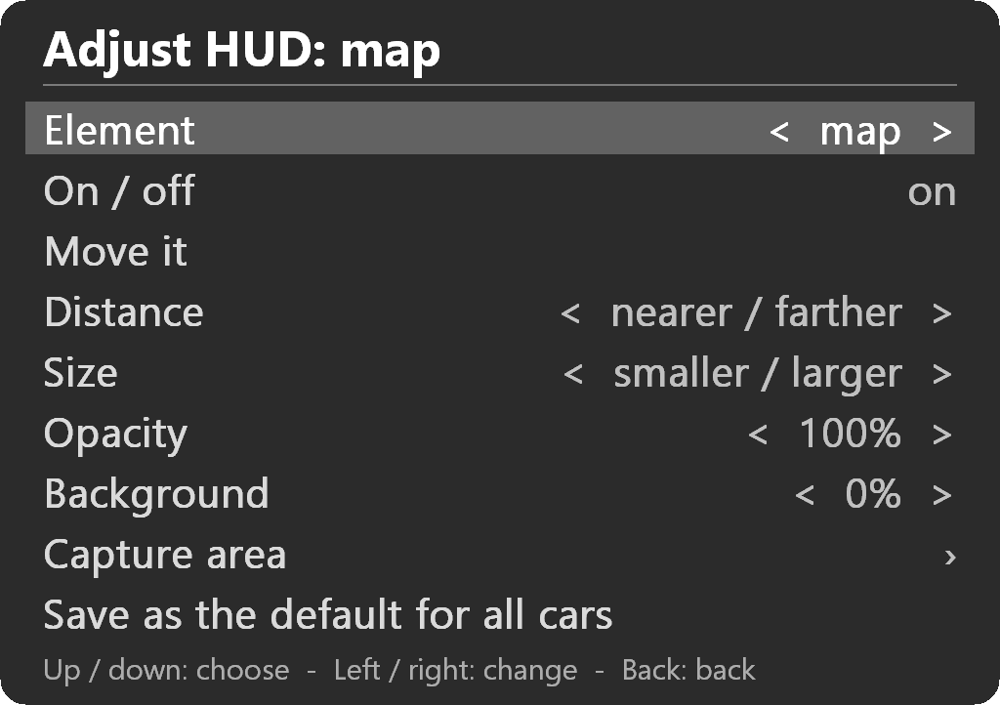
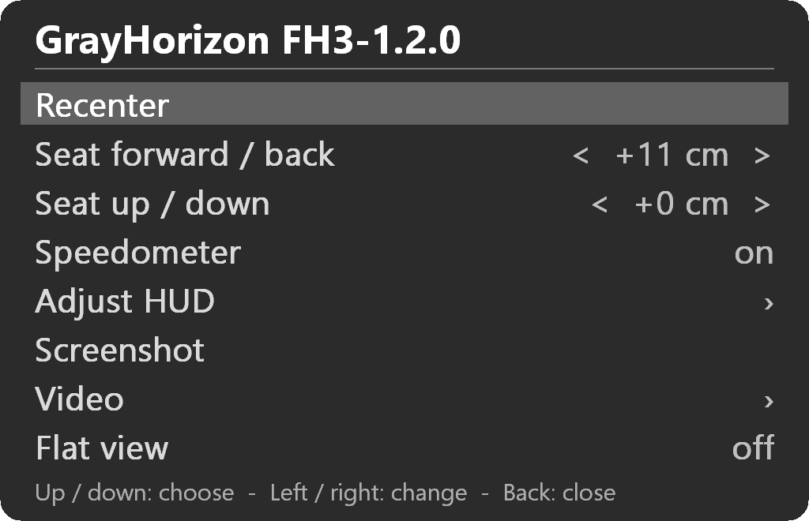

# HUD layouts & seat position

## HUD elements

The mod takes the game’s HUD apart into separate elements (minimap, speedometer, radar, race info / lap times, pop-ups, etc.) and places each one as a floating panel in the cockpit.

- Turn an element off and it disappears from both the cockpit and the main view.
- The Speedometer row (or the panels hotkey) hides/shows the speedometer for the current session.
- `hud_panels=3` in the ini turns the whole system off and leaves the game’s flat HUD.
- A new install starts with the speedometer on and no background behind any element. Set your own in Adjust HUD.

## Arranging the HUD (in-headset menu)

Press F12 (or the button you set) to open the menu, then choose **Adjust HUD**.

| Row | Action |
|-----|--------|
| Element | Left/right to pick which one |
| On/off | Toggle this element |
| Move it | Enter, then arrows move it (1 cm steps). Enter or Back when done |
| Distance | Nearer / farther |
| Size | Smaller / larger |
| Opacity | 0–100% (always-on elements only) |
| Background | Black background underneath (0–100%) |
| Capture area | Move/resize the on-screen area the HUD captures |
| Save as default for all cars | Makes the current layout the default |

Back saves the layout for the current car and returns to the main menu.  
Hold a direction to repeat.

Opacity and background only apply to always-on elements (map, speedometer, drive mode box, FH6 radar).

While Adjust HUD is open, the old calibration keys work too: Tab (next element), Ctrl+Tab (on / off), arrows (move; Shift = 1 mm), PgUp / PgDn (farther / nearer), + / - (size), Ctrl + plus / minus (opacity), Ctrl+PgUp / PgDn (background), Alt + arrows (move the capture area; Shift = 10 pixels), Ctrl + arrows (resize it).

## HUD layout per car

All HUDs can be moved so they look right. In a large truck you may want the race info higher than in a small car.

The first time you edit the HUD in a car, that car gets its own copy of the default layout.  
Changes are saved automatically when you exit the menu.  
“Save as the default for all cars” updates the default without touching cars that already have their own layout.

Capture areas are for the on-screen HUD capture, not the car, and are saved globally.

The mod knows which car you are in by the car’s own name in the game (for example `aud_rs4_06`), so per-car layouts and seat positions need no setup.

Files (next to the ini, in `Documents\GrayHorizon\FH*` on Game Pass, or in FH3’s `LocalState`):
- `gh3vr_panels.ini` / `gh4vr_panels.ini` / `gh5vr_panels.ini` / `gh6vr_panels.ini` — default layout and capture areas
- `gh3vr_car_hud.ini` / `gh4vr_car_hud.ini` / `gh5vr_car_hud.ini` / `gh6vr_car_hud.ini` — one section per car (`[aud_rs4_06]`)

Delete a car’s section to put it back on the default. To start over with the built-in layout, use **Reset to defaults** in GrayHorizon Settings (Options tab) with **HUD layouts** ticked.

## Seat position

The seat rows in the headset menu, or the seat hotkeys (Ctrl+Up / Ctrl+Down, Ctrl+PgUp / Ctrl+PgDn), move your eye point 1 cm at a time. Hold to repeat. The position is saved for the car you are in, under `[seats]` in the ini. Other cars use the default: 13 cm forward of the game’s own cockpit camera, in every game. Delete a car’s line to put it back.

## In-headset menu summary

Press **F12** (or the button you give it). The menu opens in the lower part of the view, so the windshield stays in sight. Every row shows what it is set to now.

- **Recenter** (selected when the menu opens: Enter recenters and closes it)
- **Seat forward / back** and **Seat up / down** (left / right, 1 cm a step, shown in cm)
- **Speedometer** on / off
- **Adjust HUD**
- **Screenshot** (F3). A JPEG of what you see, HUD included, in `Pictures\GrayHorizon` (FH3: the `Screenshots` folder in its `LocalState`). In a menu it saves the flat screen.
- **Video**: frame rate, performance display, stable camera, anti-aliasing, sharpness, foveated rendering, eye timing warp, flat screen size (how big the flat screen looks in the headset, -5 to +5)
- **Flat view** on / off: the whole game screen in front of you

Up / down choose a row, left / right change it, Enter selects, Back goes back a page or closes the menu. Notifications such as the frame rate still show, just above the menu.

F4 (`frame_capture`) is not in the menu. It writes large files in the game folder for a problem report.

| Default | Name | Action |
|---|---|---|
| F12 | `menu` | Open / close |
| Up / Down, D-pad | `menu_up` / `menu_down` | Choose a row |
| Left / Right, D-pad | `menu_left` / `menu_right` | Change the row |
| Enter, A | `menu_enter` | Select |
| Esc, B | `menu_back` | Back / close |

`XInput` in a binding (`XInput:HatUp`, `XInput:B1`) means any Xbox-style pad.

**What the game sees.** Only the menu button is always blocked from the game. The other controls reach the game as usual, except while the menu is on screen.  In this case the game does not see them (keys, pad and wheel buttons alike).  FH4 only reads a wheel’s first 32 buttons. A higher one can still be a hotkey.

## Using the menu on a wheel or a controller

The menu is made for a wheel’s D-pad: recenter, adjust the seat or the HUD, and other options without taking your hands off the rim.

1. Open GrayHorizon Settings. The **Menu** tab lists the key and button mappings.
2. Click **Open / close** and press the rim button you want. The game never gets this button, so pick one you do not need in the game.
3. Click **Up** and press up on the wheel’s D-pad. Do the same for **Down**, **Left** and **Right**. The box then reads like `Up, FANATEC Wheel:HatUp`.
4. Click **Enter** and **Back** and press a rim button for each. The buttons the game uses to confirm and go back are a natural fit: the game does not get them while the menu is open.
5. Click **Save**. The game picks the change up the next time it starts.

Pressing a button adds it to what is already in the box, and multiple keys or buttons can be entered.  To take a button out, delete it from the box along with its comma. While the menu is closed, the D-pad and the Enter and Back buttons work in the game as usual.
