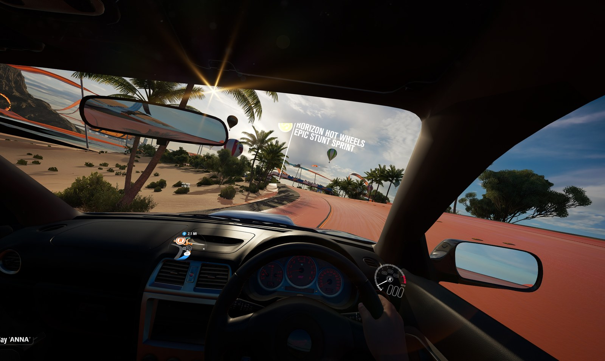
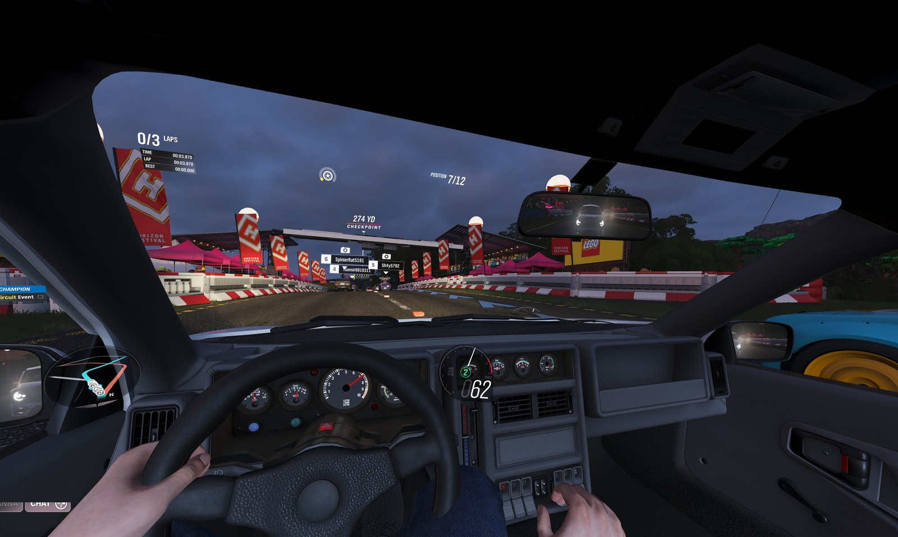
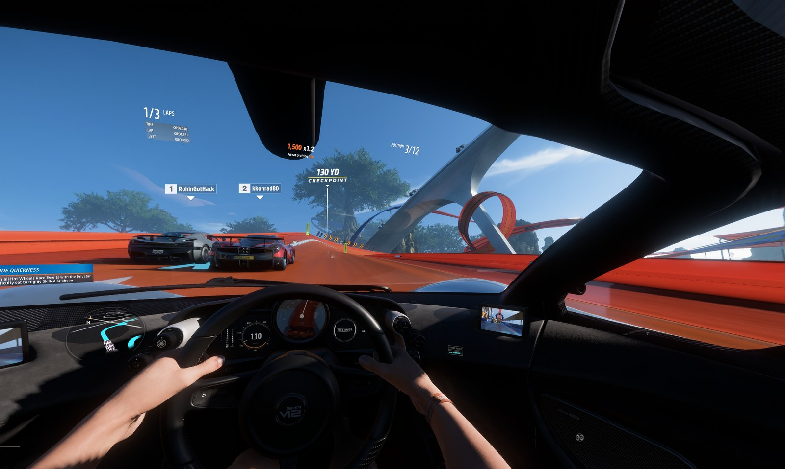
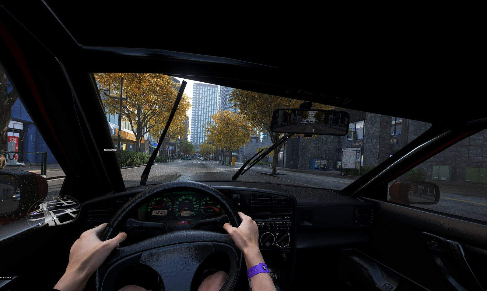

# GrayHorizon: VR mods for Forza Horizon 3, 4, 5 and 6

Not affiliated with Playground / Turn 10 / Xbox / Microsoft.  Use at your own risk.

Four separate injectors (one per game) that share the same design and the same settings program.  
Each gives a stereo 3D cockpit view with full head tracking through OpenXR.

**Official downloads are only from the [Releases](https://github.com/GrayHorizon-mod/Forza-Horizon-VR/releases/latest) page.**  
One zip per game: `GrayHorizon-FH3/4/5/6-<version>.zip`.  
Anything else is not maintained by me.

**New in v1.2:** Forza Horizon 3 support, learning mode (experimental), FSR upscaling, flat screen zoom adjustment, many bug fixes and small improvements.  
A big Thanks to **Cammo Freak** (`@cammofreak` on Discord) for their help with FH3!!

**BREAKING CHANGE:** Telemetry (data out) is no longer needed or supported. If you were using it before to forward your data out to another program, you will need to put that program's IP and port back into the game settings.  
The full list of changes is on the [release page](https://github.com/GrayHorizon-mod/Forza-Horizon-VR/releases/latest).

GrayHorizon is free.  If it provides enjoyment for you, [tips are welcome](https://www.ko-fi.com/GrayHorizon), but you are under no obligation to do so.

## Quick start

1. Download the zip for your game from Releases.
2. Extract the files next to the game’s `.exe`:
   - Steam: right-click the game → Manage → Browse local files.
   - Game Pass / Microsoft Store (FH5 & FH6 only): Xbox app → Manage → Files → Content folder. Rename `xinput1_3.dll` to `xinput1_4.dll`.
   - FH3 (Microsoft Store) is different: unzip it into a folder of your own and start the game with `GrayHorizon FH3.exe`. It needs SteamVR as the OpenXR runtime. See [Forza Horizon 3](INSTALL.md#forza-horizon-3).
3. Video: V-Sync off, frame rate unlocked, motion blur off, TAA/FXAA/DLSS/FSR/Frame Gen off, HDR off, Dynamic Optimization off (FH3/FH4).
4. HUD and gameplay: Make sure your HUD Safe Frame is set to the default.  These are Horizontal 7 / Vertical 20 in FH3, Horizontal 8 / Vertical 37 in FH4, and Horizontal 5 / Vertical 9 in FH5 and FH6. In FH6, set Radar position to Center right.
5. Launch with the headset connected and switch to cockpit view.
6. Press `Ctrl+Space` to recenter (it also recenters automatically the first time the headset reports you’re wearing it).
7. Adjust the seat/head position, HUDs, video options with the `F12` key to bring up menu.  By default, use the arrow keys, `Enter`, and `ESC` to navigate.

**Learning mode:  --Experimental--** 
- The mod can help adjust your resolution and scaling for optimum performance and the best quality in usually around 10 minutes.
- The first startup with a new headset runs initial setup, and the headset will ask you to restart the game.
- The next few times (generally only 3 but up to 5) the game is started, learning begins: drive at least 3 minutes, then restart anytime after the headset says so.
- After learning mode is complete, the size it learned for your PC will be saved.  Please note the image or fps may get worse before getting better when learning mode is active as different adjustments are measured.  See [Learning mode](SETTINGS.md#learning-mode).

Uninstall = delete the files you copied (and the `Documents\GrayHorizon` folder on Game Pass). FH3: run `Uninstall GrayHorizon FH3.cmd`, then delete its folder.

Full install steps, Game Pass notes, and the FH4 Save Converter are in [INSTALL.md](INSTALL.md).

## Compatibility

| Game | Tested version | Notes |
|------|----------------|-------|
| Forza Horizon 3 | Microsoft Store 1.0.125.x | Microsoft Store, started with `GrayHorizon FH3.exe`. SteamVR only (FH3 runs in Windows’ app sandbox). See [Forza Horizon 3](INSTALL.md#forza-horizon-3). |
| Forza Horizon 4 | Steam 1.478.564.0 | Steam only. Use the [FH4 Save Converter](https://github.com/GrayHorizon-mod/FH4-Save-Converter) to move progress from the old Store/Game Pass version. |
| Forza Horizon 5 | Steam 1.688.109.0 / Store 3.688.109.0 | Steam and Game Pass / Microsoft Store |
| Forza Horizon 6 | Steam 6.461.691.0 / Store 3.461.691.0 and later | Steam and Game Pass / Microsoft Store |

A game update can potentially break the hooks.  FH6 has been built to generally survive updates.

## Features

- Stereo 3D cockpit with head tracking (alternating frames — game must hit 2× headset refresh)
- Learning mode: finds the best picture and scaling size for your PC, usually in less than 10 minutes
- Stable cockpit camera (removes game head-bob / g-force lean) - great for motion simulators
- HUD broken into floating panels you can place per car (minimap, speedometer, race info, etc.)
- Seat/head position adjustable per car and automatically saved
- Canted per-eye rendering, optional foveated rendering and picture trim
- DLSS (NVIDIA RTX) or FSR (any graphics card) in every game, or the mod’s own TAA
- In-headset menu (F12, or use wheel/controller) allows control of everything without removing your headset
- The mod can be fully disabled while staying installed by an option in the settings program
- Motion compensation via OpenXR is supported

## Requirements

- One of the game versions above (own the game; this does not include any game files)
- A PC VR headset with an OpenXR runtime.  **FH3 works with SteamVR only.** See [SteamVR](TECHNICAL.md#steamvr) for more information.
- Strong enough CPU/GPU to run the game at 2× the headset refresh rate
- NVIDIA RTX for DLSS. FSR and the mod's own TAA work on any card.

Online play is at your own risk. The mods hook camera and rendering.

## More

- [Full install (Steam & Game Pass)](INSTALL.md)
- [Game settings & config file options](SETTINGS.md)
- [HUD layouts, seat position, headset menu](HUD-AND-SEAT.md)
- [Performance notes & suggested settings](PERFORMANCE.md)
- [Technical details, SteamVR and known issues](TECHNICAL.md)

## Reporting a problem

Open an [issue](https://github.com/GrayHorizon-mod/Forza-Horizon-VR/issues) or join the discussion in the [Flat2VR Modding Discord](https://discord.gg/flat2vr), under Other VR Modding → new-vr-mods, in the thread “Forza Horizon 3, 4, 5, and 6 - GrayHorizon VR”.

If opening an issue:

1. Try safe mode first (`safe_mode=1`, or the box in GrayHorizon Settings). If the problem is gone, turn the extras back on one at a time.
2. Attach the log from a run where it happened. Steam: the game folder (`gh4vr.log` / `gh5vr.log` / `gh6vr.log`). Game Pass: `Documents\GrayHorizon\FH5` or `FH6`. FH3: `%LOCALAPPDATA%\Packages\Microsoft.OpusPG_8wekyb3d8bbwe\LocalState` (`gh3vr.log`; paste the path into Explorer’s address bar). The log is replaced at each launch. The previous three are kept as `...prev1.log` to `...prev3.log`. The `==== summary` block lists your GPU, headset, OpenXR runtime and the settings. If the game crashed, the end of the log says where.
3. Say what you saw and when: in the cockpit or a menu, one eye or both, and which key or button you had just pressed.
   

Source is not public yet.
