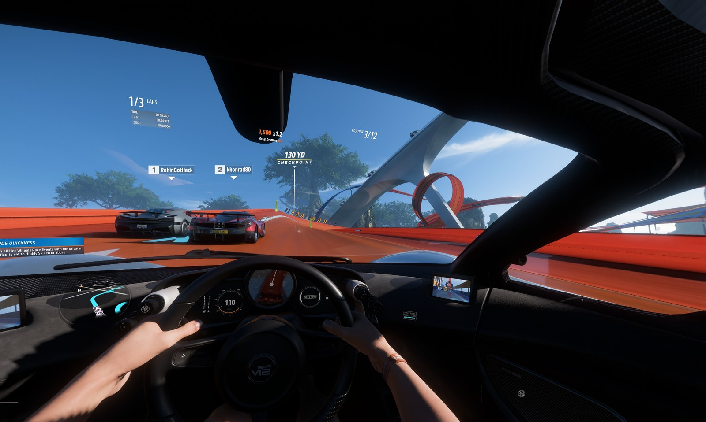
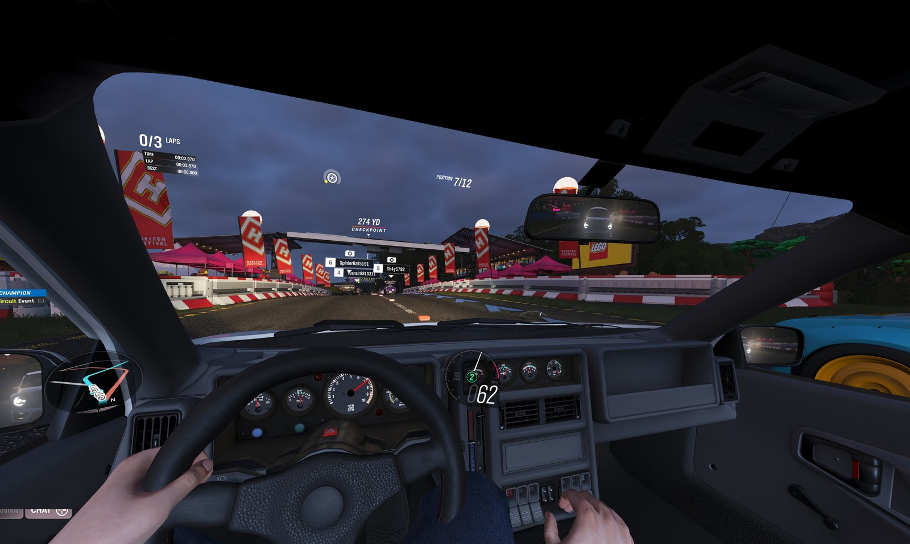
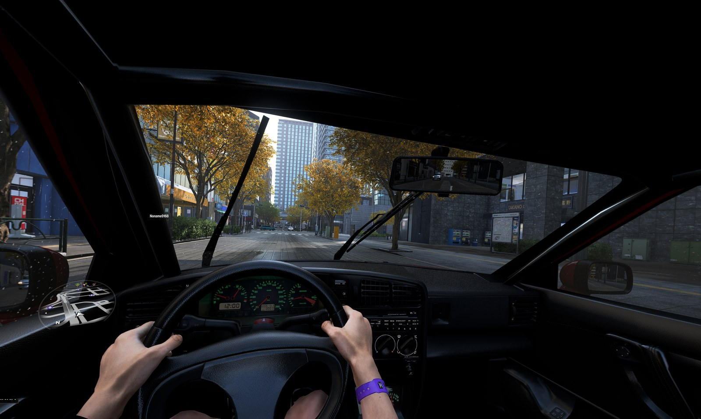

# GrayHorizon: VR mods for Forza Horizon 4, 5 and 6

Not affiliated with Playground / Turn 10 / Xbox / Microsoft.  
Use at your own risk.

Three separate injectors (one per game) that share the same design and the same settings program.  
Each gives a stereo 3D cockpit view with full head tracking through OpenXR.

**Official downloads are only from the [Releases](https://github.com/GrayHorizon-mod/Forza-Horizon-VR/releases/latest) page.**  
One zip per game: `GrayHorizon-FH4/5/6-<version>.zip`.  
Anything else is not maintained by me.

GrayHorizon is free.  If it provides enjoyment for you, [tips are welcome](https://www.ko-fi.com/GrayHorizon), but you are under no obligation to do so.

## Quick start

1. Download the zip for your game from Releases.
2. Extract the files next to the game’s `.exe`:
   - Steam: right-click the game → Manage → Browse local files.
   - Game Pass / Microsoft Store (FH5 & FH6 only): Xbox app → Manage → Files → Content folder. Rename `xinput1_3.dll` to `xinput1_4.dll`.
3. In the game: V-Sync off, frame rate unlocked, motion blur off, TAA/FXAA/DLSS/FSR/Frame Gen off, HDR off (FH5/FH6).
4. Data Out on (127.0.0.1:20440) if you want per-car HUD layouts.
5. Launch with the headset connected and switch to cockpit view.
6. Press `Ctrl+Space` to recenter (it also recenters automatically the first time the headset reports you’re wearing it).

Uninstall = delete the files you copied (and the `Documents\GrayHorizon` folder on Game Pass).

Full install steps, Game Pass notes, and the FH4 Save Converter are in [INSTALL.md](INSTALL.md).

## Compatibility

| Game | Tested version | Notes |
|------|----------------|-------|
| Forza Horizon 4 | Steam 1.478.564.0 | Steam only. Use the [FH4 Save Converter](https://github.com/GrayHorizon-mod/FH4-Save-Converter) to move progress from the old Store/Game Pass version. |
| Forza Horizon 5 | Steam 1.688.109.0 / Store 3.688.109.0 | Steam and Game Pass / Microsoft Store |
| Forza Horizon 6 | Steam 6.461.691.0 / Store 3.461.691.0 | Steam and Game Pass / Microsoft Store |

A game update can break the hooks. On an unrecognized version the mod stays out of the way and the game runs normally (no VR).

## What you get

- Stereo 3D cockpit with head tracking (alternating frames — game must hit 2× headset refresh)
- Stable cockpit camera (removes game head-bob / g-force lean)
- HUD broken into floating panels you can place per car (minimap, speedometer, race info, etc.)
- Per-car seat position
- Canted per-eye rendering, optional foveated rendering, picture trim
- DLSS (NVIDIA) or the mod’s own TAA; FH4 also has FSR
- In-headset menu (F12) and GrayHorizon Settings app
- Motion compensation via OpenXR-MotionCompensation if you have it

## Requirements

- One of the game versions above (own the game; this does not include any game files)
- PC VR headset with an OpenXR runtime (tested mainly on Pimax OpenXR and SteamVR)
- Strong enough CPU/GPU to run the game at 2× the headset refresh rate
- NVIDIA RTX for DLSS (FH4 falls back to FSR on other cards)

Online play is at your own risk. The mods hook camera and rendering.

## More

- [Full install (Steam & Game Pass)](INSTALL.md)
- [Game settings & ini options](SETTINGS.md)
- [HUD layouts, seat position, headset menu](HUD-AND-SEAT.md)
- [Performance notes & suggested settings](PERFORMANCE.md)
- [Technical details](TECHNICAL.md)

Issues: use the [Issues](https://github.com/GrayHorizon-mod/Forza-Horizon-VR/issues) tab.  
Include game version, headset, runtime, and what you did right before it broke.

Source is not public yet.

**FH4 progress in the Microsoft Store / Game Pass version?** The FH4 mod needs the Steam version, but your progress can come with you: the [GrayHorizon FH4 Save Converter](https://github.com/GrayHorizon-mod/FH4-Save-Converter) moves an FH4 profile from the Store version to Steam, or back. You need both versions, signed in with the same Xbox account.
 
