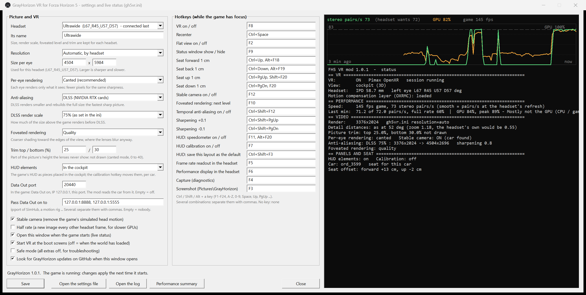

# Game settings & ini options

The same for every version of the games. Set these in the game’s own menus.

## Required game settings

- **Video**: V-Sync off, frame rate unlocked, motion blur off.  
  TAA / FXAA / DLSS / FSR / Frame Generation / XeSS / CAS / etc. off.  
  Any other video enhancement besides MSAA (FH4/FH5) is unsupported. Use the mod’s own TAA or DLSS/FSR.
- **HDR off** (FH5 and FH6; FH4 has no HDR setting):  
  Settings → Video → HDR, or turn HDR off in Windows (Settings → Display → Use HDR, or Win+Alt+B).  
  With HDR on, the Meta/Quest runtime cannot take the picture and VR stays off for that run. The status window and log will say so.
- **HUD and gameplay**: leave the HUD Safe Frame sliders at their default position. The cockpit HUD elements are made for it; other values make them cut off or empty.
- **Data Out**: ON, IP address `127.0.0.1`, port `20440`.  
  Required for per-car HUD layouts and seat positions. See [HUD-AND-SEAT.md](HUD-AND-SEAT.md).
- Keep Environment Geometry and Environment Texture high (Extreme if the system can handle it). Lowering them causes late pop-in of cones, barriers, and roadside objects.
- **FH6 only**: Settings → HUD and gameplay → Radar position: Center right. The radar element is made for that position.

You never need to edit the game’s own settings file. The mod writes the render size it needs before the game reads it.

## GrayHorizon Settings app

`GrayHorizon Settings.exe` is included in every zip.  
It shows live status while the game is running, lets you change most options without editing the ini by hand, and checks for updates on GitHub.

Hotkeys (editable on the right side of the window):
- F12 (or a wheel/pad button) — in-headset menu
- F5 — frame-rate readout
- F6 — performance summary (last 30 seconds)
- Ctrl+Space — recenter

## Key ini options

The ini lives next to the game (Steam) or in `Documents\GrayHorizon\FH5` / `FH6` (Game Pass).

| Setting | Values | Notes |
|---------|--------|-------|
| `resolution` | `auto`, `WIDTHxHEIGHT`, `off` | `auto` uses the per-headset table. Recommended. |
| `upscale` | `dlss`, `fsr` (FH4), `off` | DLSS on NVIDIA RTX. FH4 falls back to FSR on other cards. |
| `upscale_scale` | 0.5–1.0 | 0.67 quality, 0.58 balanced, 0.5 performance. 1.0 = AA only. |
| `anti_aliasing` | 0 or 1 | Mod’s own temporal AA when not using an upscaler. |
| `per_eye` / `canted` | see TECHNICAL.md | Canted per-eye is the recommended mode. |
| `trim_top` / `trim_bottom` | 0–40 | Percent of height not drawn (canted mode). Start at 0. |
| `afr_warp` | 0 or 1 | Eye timing warp. On by default. Costs a little GPU. |
| `detail_fov` | `auto`, number, 0 | Controls how far the game draws detailed models. |
| `update_check` | 0 or 1 | Whether Settings looks for updates on launch. |

Per-headset sizes go under `[resolutions_canted]` (or `[resolutions]`).  
Example:
